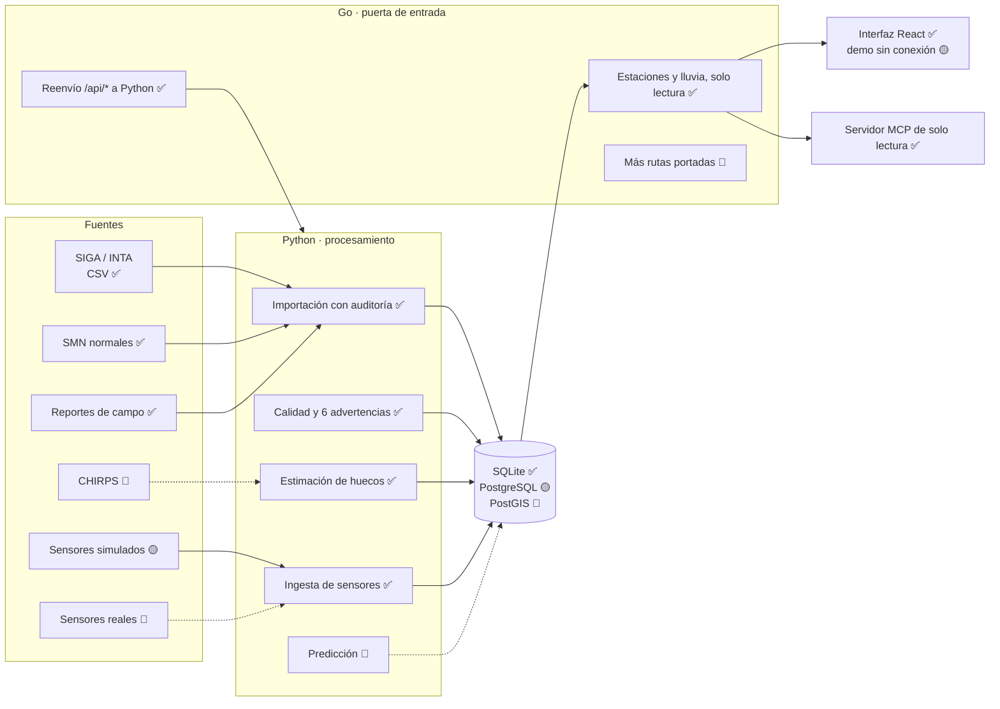

# Arquitectura objetivo y hoja de ruta

> **PROTOTIPO · AI LAB Misión: Código Formosa · no es una herramienta oficial**

Tarea SCRUM-95. Escrito para un lector ajeno al equipo. Separa con claridad lo que **existe hoy en el repositorio** (rama `qa`, 19/11/2026) de lo que **se propone** para seguir a escala. Lo propuesto no está construido ni probado, y ninguna cifra de esta hoja de ruta es una promesa de fecha.

Marcas que se usan en todo el documento:

| Marca | Significa |
|---|---|
| ✅ **Hoy** | Está en el repositorio y tiene pruebas |
| 🟡 **Hoy, limitado** | Existe, pero con un límite que se dice en el texto |
| 🔭 **Propuesta** | No existe; es lo que se haría a escala |

El plan de trabajo original del 18/11 está en el [Plan v2](https://claude.ai/artifact/MSmWaGjM9qRtgk6cbyfxa4). El diagrama de abajo parte de ese plan y lo actualiza con lo que realmente quedó construido.

## 1. Qué problema resuelve

Responde ¿cuánto llovió, dónde y en qué período?, mostrando siempre la calidad del dato. Reglas que no cambian en ninguna parte (ver `AGENTS.md`): un hueco no es 0 mm; observado, referencia y estimado van separados; corte de datos 31/10/2026; todo dato lleva fuente y categoría; no se inventa nada.

## 2. Diagrama: hoy y propuesta

Lectura: las líneas continuas existen; las punteadas son propuesta.

## 3. Pieza por pieza

### Go como puerta de entrada
- ✅ **Hoy.** `apps/api-go` responde `/health`, usa el formato único de errores, limita pedidos por cliente y **reenvía el resto de `/api/*` a Python** con el mismo contrato (`openapi.yaml`). Atiende por sí mismo `GET /api/stations`, `GET /api/stations/{id}` y `GET /api/rainfall`, leyendo la base en solo lectura, con 47 consultas comparadas contra Python.
- 🟡 **Límite.** Para leer la base necesita compilarse con el driver de SQLite (`-tags sqlite`); sin él arranca igual y reenvía a Python. **Con PostgreSQL todavía no lee.** El comparador, los acumulados, el parte y la importación siguen saliendo de Python.
- **Por qué Go:** decisión del equipo del 19/11, por rapidez de respuesta en las consultas. Se midió una mejora de 1,7 a 5,5 veces menos tiempo por pedido en la base de demostración; es una medición chica, **no una prueba de carga** (detalle en `docs/decisiones/2026-11-19-puerta-go.md`).
- 🔭 **A escala.** Portar a Go, de a una y con prueba de paridad contra Python, las demás rutas de consulta; y leer también de PostgreSQL.

### Python para datos e IA
- ✅ **Hoy.** `apps/backend` (FastAPI, SQLAlchemy 2, Alembic) es el único que escribe en la base y responde todas las rutas `/api/*`: importación con auditoría fila por fila, las seis advertencias de comparabilidad, parte pluvial, reportes de campo, ingesta de sensores simulados y estimación de huecos.
- **Por qué Python:** es donde está el ecosistema de datos, y el procesamiento no es sensible a la latencia de una consulta.
- 🔭 **A escala.** Los trabajos pesados (importaciones grandes, estimaciones, y la predicción de abajo) pasarían a una cola de trabajos aparte, en lugar de correr en el mismo proceso que la API.

### PostgreSQL con PostGIS
- ✅ **Hoy.** SQLite en la demo, con restricciones en la base que impiden guardar un hueco como 0 mm.
- 🟡 **Hoy, limitado.** Cambiar a PostgreSQL es cambiar `DATABASE_URL`; se comprobó el 19/11 con PostgreSQL 16 en una máquina de trabajo (migraciones, importación real y los mismos acumulados que en SQLite). **No se verificó:** la suite completa contra PostgreSQL en CI, concurrencia ni volumen. El driver `psycopg` no está en `requirements.txt`. **PostGIS no se usa**: las capas geográficas son archivos GeoJSON del IGN.
- **Por qué:** PostgreSQL aguanta varios procesos escribiendo y lectores a la vez; SQLite es suficiente para una demo y no para varios operadores.
- 🔭 **A escala.** PostgreSQL como base por defecto, la suite de pruebas corriendo también contra él en CI y, con PostGIS, consultas por zona y cercanía (estación más próxima, lluvia dentro de un polígono) en lugar de resolverlas en la interfaz.

### Sensores
- 🟡 **Hoy, limitado.** Existe el contrato de ingesta `POST /api/sensor-readings` (clave de dispositivo, idempotente, día con corte de Argentina), un simulador (`python -m simulador`) y una pantalla. **Todo lo que entra es simulado y se rotula así** (`simulado`): no se mezcla con observado.
- 🔭 **A escala.** Conectar equipos reales. Cuál es el equipo, el medio de comunicación y quién lo mantiene **no está definido**: es una decisión pendiente, y no se inventa acá. Un sensor real pasaría por la misma validación y entraría con su categoría y su estado de validación.

### Predicción
- 🔭 **Propuesta, no existe.** No hay ningún modelo en el repositorio. Se propone, como último paso y solo si hay histórico suficiente, un estimador que se guarde **siempre como `estimado`, rotulado y aparte** de lo observado, con su método y sus parámetros a la vista, igual que hoy la estimación de huecos (`docs/datos/estimacion-huecos.md`).
- ✅ **Lo que sí existe y es el antecedente:** la estimación rotulada de días sin dato. Hoy da **0 días estimados con los datos reales**, porque las únicas estaciones cercanas cuentan el «día» distinto y no son comparables; es el resultado correcto y está explicado en ese documento.
- **Condición para avanzar:** medir el error contra datos que el modelo no vio antes de mostrar nada.

### Trabajo sin conexión
- 🟡 **Hoy, limitado.** La demo corre **sin internet**: SQLite local, sin recursos externos y con el mapa base local (el mapa de OpenStreetMap es opcional con `VITE_MAPA_BASE=osm`). Una prueba automática falla si alguien agrega una dirección externa a la interfaz. Esto no es trabajo en el campo sin conexión.
- 🔭 **A escala.** Que quien carga datos en el campo pueda anotar sin red y sincronizar después (cola local y reenvío con control de duplicados). Falta definir **quién** es ese usuario (jurado, equipo de campo o quienes cargan datos); el Plan v2 lo deja como pregunta abierta.

### MCP
- ✅ **Hoy.** Servidor MCP de **solo lectura** (`apps/backend/servidor_mcp`, `docs/entrega/mcp.md`): cuatro herramientas que consultan la API por HTTP `GET`, sin acceso a la base ni a la clave de administración. Una consulta sin datos responde «sin dato», no 0. Se verificó por stdio contra la API real; **no se probó con un cliente MCP real**.
- 🔭 **A escala.** Publicarlo con autenticación y límite de uso, y sumar herramientas solo si siguen siendo de lectura.

## 4. Qué es prototipo hoy y qué se haría a escala

| Aspecto | Hoy (prototipo) | A escala (propuesta) |
|---|---|---|
| Base | SQLite; PostgreSQL probado en una máquina | PostgreSQL con PostGIS, probado en CI |
| Consultas | Go sirve 3 rutas; el resto, Python | Más rutas en Go, con paridad probada |
| Escritura | Python, un proceso | Python con cola de trabajos |
| Datos | SIGA/INTA, SMN, reportes de campo | + INA, CHIRPS, sensores reales (licencias y coordenadas por confirmar) |
| Sensores | Simulados y rotulados | Reales, misma validación |
| Predicción | No existe | Estimado, aparte y medido |
| Sin conexión | Demo local | Carga en campo con sincronización |
| Seguridad | Clave de administración y de dispositivo, límite de pedidos | Cuentas por persona y registro de quién cargó qué |

## 5. Hoja de ruta propuesta (en orden)

El orden pone primero lo que protege el dato. No lleva fechas porque no hay un equipo ni un plazo definidos más allá de la entrega.

1. **Cerrar lo verificable.** Probar la demo en un entorno limpio, con la clave y el entorno de producción separados, y revisar los límites que figuran en este documento.
2. **PostgreSQL en CI.** Correr la suite completa contra PostgreSQL y agregar `psycopg` a las dependencias.
3. **Completar Go.** Portar de a una las rutas de consulta restantes, con paridad contra Python; Go lee de PostgreSQL.
4. **PostGIS.** Pasar las capas y las consultas por zona a la base; recién entonces dejar de depender de archivos GeoJSON para la lógica.
5. **Más fuentes.** Incorporar INA y CHIRPS **solo con licencia confirmada y coordenadas verificadas**.
6. **Sensores reales.** Definir equipo, comunicación y mantenimiento; reutilizar el contrato de ingesta.
7. **Carga en campo sin conexión.** Después de definir el usuario.
8. **Predicción.** Última, solo con histórico y medición de error, siempre como estimado.

## 6. Qué falta decidir al equipo

- Qué equipo de sensores, si alguno.
- Quién es el usuario que trabaja sin conexión.
- Licencia de los datos del INA y coordenadas pendientes de varias estaciones.
- Confirmar por escrito el alcance abierto con fundamento (`docs/decisiones/`).
- Si se mantiene Go como API principal después de la entrega.
