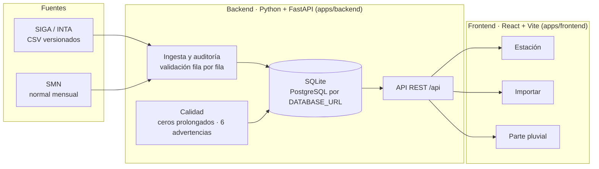

# Ficha técnica de PLUVIFOR

> **PROTOTIPO · AI LAB Misión: Código Formosa · no es una herramienta oficial**

Tarea SCRUM-59. Describe el sistema **tal como está en el repositorio** (rama `qa`, 19/11/2026). Lo que todavía no existe figura como pendiente en la sección 9. Equipo 5 «SpaidyCode», UTN, Extensión Áulica Formosa. Desafío 2 · Reporte pluvial de la *Operación Agua* (AI LAB «Misión: Código Formosa»).

## 1. Qué problema resuelve

Responde ¿cuánto llovió, dónde y en qué período?, **mostrando siempre la calidad del dato**. La idea central: **un hueco no es 0 mm**. Un día sin dato se guarda, se devuelve y se muestra como «sin dato», nunca como 0, y se distingue entre `sin_fila` (el día no existe en la fuente) y `fila_sin_valor` (el día existe, sin valor).

## 2. Arquitectura

Son dos programas que se ejecutan por separado y se hablan por HTTP, más una base de datos.



**Importante para quien lea el plan original:** el plan hablaba de una API en **Go** y un procesamiento en Python. **En el repositorio no hay una API en Go**: toda la API y el procesamiento están en Python (FastAPI). El diagrama del Plan v2 no está en el repositorio, por eso no se reprodujo; el de arriba refleja lo implementado. Si el equipo decide que Go es obligatorio, es una tarea nueva, no un detalle pendiente.

### Capas del backend (`apps/backend/app/`)

| Capa | Qué hace | Ejemplos |
|---|---|---|
| `api/` | Rutas delgadas: leen parámetros, llaman al servicio, devuelven la respuesta | `rainfall.py`, `imports.py`, `reports.py` |
| `services/` | Orquestan un caso de uso | `importer.py`, `series.py`, `report.py`, `quality.py` |
| `domain/` | Reglas puras, sin base de datos ni HTTP | `metrics.py`, `quality.py`, `warnings.py`, `report.py` |
| `repositories/` | Todo el acceso a la base (SQLAlchemy) | `ingestion.py`, `series.py`, `quality.py`, `references.py` |
| `ingestion/` | Conectores y validación de filas | `siga.py`, `stations.py`, `validation.py` |
| `models/` y `schemas/` | Tablas y formas de entrada y salida (Pydantic) | |

Las dependencias van hacia adentro: la lógica depende de interfaces (por ejemplo un repositorio con `Protocol`), recibidas por el constructor. Eso permite probar las reglas sin base de datos.

## 3. Cómo viaja un dato

1. **Entra** un CSV (`POST /api/import/audit` para revisarlo, `POST /api/import/commit` para guardarlo). Todas las rutas de `/api/import` piden una clave de administración.
2. **Se valida fila por fila**: cada fila se acepta o se rechaza con un motivo (hay 10 motivos para lluvia y 3 para estaciones). Nada se descarta en silencio. Detalle en `docs/entrega/registro-de-limpieza.md`.
3. **Se guarda** de forma atómica, con una fila en `import_logs` (archivo, SHA-256, filas leídas, aceptadas y rechazadas, fecha de corte).
4. **Se recalculan las banderas de calidad** (tramos de 60 días o más con 0 mm).
5. **Se consulta**: serie por estación y período, acumulados por estación o zona, y un parte pluvial de hasta 20 estaciones. Cada respuesta trae fuente, categoría y advertencias.

## 4. Modelo de datos

Detalle completo, con diagrama, en `docs/modelo-datos.md`. Resumen:

| Tabla | Para qué |
|---|---|
| `sources` | De dónde viene cada dato: red, categoría, horario de corte del «día», licencia |
| `stations` | Dónde se mide; las coordenadas pueden estar pendientes (no se inventan) |
| `rainfall_records` | La lluvia: una fila por estación, día y categoría, con su estado (`dato`, `fila_sin_valor`, `sin_fila`) |
| `quality_flags` | Advertencias que abarcan un período (hoy: ceros prolongados) |
| `import_logs` | Una fila por carga: base de la auditoría |
| `climate_references` | Normales climáticas (referencia), con período y fuente |

**La regla del hueco está en la base, no solo en el código:** una restricción obliga a que `mm` tenga valor si y solo si el estado es `dato`, y otra impide valores negativos. Intentar guardar un hueco como 0 falla.

**Categorías:** `observado`, `referencia` y `estimado` van separadas y **nunca se suman ni se promedian entre sí**.

**Fecha de corte:** 31/10/2026. Las filas posteriores se rechazan y un período que la pasa se recorta y se avisa.

## 5. Las seis advertencias de comparabilidad

Cada advertencia es una regla independiente (`apps/backend/app/domain/warnings.py`) que cumple la misma interfaz; agregar una séptima no obliga a tocar las otras.

| Código | Qué advierte | Umbral | Dónde aparece hoy |
|---|---|---|---|
| `horario_corte_distinto` | Las redes cortan el «día» a horas distintas (07:00 contra 09:00) | Cortes distintos | Parte pluvial, al comparar estaciones |
| `observado_vs_estimado` | Se comparan datos medidos con estimados | Categorías distintas | Parte pluvial |
| `cobertura_despareja` | Una serie tiene mucha más cobertura que otra | Diferencia de 0,2 | Parte pluvial |
| `dato_sin_validar` | Los datos no pasaron una validación externa | Todo dato entra «sin validar» | Serie, acumulado y parte |
| `ceros_prolongados` | 60 días o más seguidos con 0 mm: puede ser un sensor sin registrar | 60 días | Serie, acumulado y parte |
| `inconsistente_con_vecinas` | Esta estación marca poco mientras una vecina marca mucho | Vecina a 150 km o menos, 50 mm o más y cobertura de la vecina de 0,5 o más | Parte pluvial |

Además, la serie y el acumulado avisan `cobertura_baja` cuando la cobertura es menor que 0,8 (**umbral provisional, pendiente de confirmar**). Un caso real que lo muestra: la estación 424 marca 0 mm durante 281 días (20/09/2015 a 26/06/2016) mientras la 425, a unos 100 km, registra 1.265 mm; el sistema lo advierte y no lo da por bueno.

Los **umbrales** (60 días, 0,2, 150 km, 50 mm, 0,5 y 0,8) los eligió el equipo y **no están validados con la mentoría**.

## 6. Stack y versiones

| Parte | Tecnología | Versión |
|---|---|---|
| Backend | Python | 3.12 (el CI usa 3.12) |
| | FastAPI / Uvicorn | 0.163.2 / 0.54.0 |
| | SQLAlchemy / Alembic | 2.1.9 / 1.20.1 |
| | Pydantic Settings | 2.16.3 |
| | Pruebas y estilo | pytest 9.2.0, httpx 0.28.1, ruff 0.17.5 |
| Base de datos | SQLite (demo); PostgreSQL cambiando `DATABASE_URL` | PostgreSQL 16 probado en local |
| Frontend | React / React Router | ^19.3.1 / ^7.18.5 |
| | TypeScript / Vite | ~7.0.2 / ^8.3.6 |
| | Recharts / Leaflet y react-leaflet | ^3.11.0 / ^1.9.4 y ^5.0.0 |
| | Vitest / Oxlint / Prettier | ^5.1.0 / ^1.90.0 / ^3.10.1 |
| Capas geográficas | GeoJSON del IGN, dentro del repositorio (`apps/frontend/public/geo/`) | |
| CI | GitHub Actions: backend (ruff + pytest), frontend (lint, pruebas y build, con Node 22) y escaneo de secretos (gitleaks) | |

Las versiones del backend están fijadas; las del frontend son los rangos de `package.json` (las exactas quedan en `package-lock.json`).

## 7. Decisiones de diseño

| Decisión | Por qué |
|---|---|
| Reglas de calidad como objetos intercambiables con una interfaz común (Strategy) | Agregar o ajustar una advertencia sin tocar las demás |
| Acceso a datos detrás de repositorios (Repository) | Probar la lógica sin base y cambiar de motor |
| Una fuente nueva es un conector más (Adapter) y una fila en `sources` | Sumar INA o la red provincial sin cambiar el esquema |
| Restricciones en la base, no solo validación en código | La regla del hueco no se puede saltear por error |
| Guardar también los días `sin_fila` | La cobertura se calcula directamente; cuesta más filas, sin problema a esta escala |
| Un dato observado y uno estimado pueden convivir el mismo día (clave por estación, fecha y categoría) | Para mostrarlos separados |
| Cada carga queda registrada con su SHA-256 | Poder auditar de dónde salió cada dato |

## 8. Seguridad (resumen)

Se revisó con una lista y el resultado está en `docs/entrega/informe-seguridad.md`, junto con lo que quedó sin resolver y por qué. Resumen: validación de toda entrada con Pydantic; consultas por el ORM (sin SQL armado con texto); límite de 5 MB por archivo y de 64 KB para el resto de los pedidos; límite de pedidos por minuto; encabezados de seguridad; clave de administración para toda la importación; secretos fuera del código (`.env` ignorado por Git y gitleaks en el CI). Las dependencias se auditaron en `docs/entrega/auditoria-dependencias.md`.

## 9. Qué es prototipo y qué se haría a fondo

**Hoy funciona:** importación con auditoría, serie diaria y acumulados por estación y zona, las advertencias, la ficha de estación, el parte pluvial imprimible, el registro de cargas y el recálculo de banderas. Está probado con datos reales del SIGA (7.648 filas, 3 estaciones).

**Todavía no existe (pantallas de marcador o tareas abiertas):**

- Mapa provincial, comparador, salud de la red y ayuda: en el frontend son pantallas de marcador. La comparación de estaciones de la API (`/api/rainfall/compare`) tampoco está entregada.
- Datos de la red provincial, UPCA, SNIH, INA y CHIRPS: **ninguno está cargado**. Del INA hay solo un listado de estaciones. Ver `docs/fuentes/README.md`.
- La normal mensual es de **una sola estación** (Formosa Aero, SMN) y no representa a toda la provincia.
- Las coordenadas de varias estaciones siguen pendientes. Además, el sistema marca una estación como «coordenadas verificadas» cuando trae latitud y longitud, sin comprobar su origen.
- El SIGA cargado termina entre 2015 y 2023: **no hay datos del período 2026** (El Niño 2026/27) en el sistema.
- El driver de PostgreSQL (`psycopg`) no está en `requirements.txt`; hay que instalarlo a mano.

**Qué se haría a fondo con más tiempo:**

- Cargar las redes que faltan, con su licencia confirmada y sus cortes horarios verificados.
- Validar los umbrales de las advertencias con la mentoría y un especialista.
- Que las banderas y la validación de datos las confirme una persona, no solo las reglas automáticas.
- Autenticación real por usuario (hoy hay una sola clave de administración) y despliegue con HTTPS.
- Pruebas de punta a punta en navegador y en teléfonos reales.
- Una carga automática desde las APIs de las fuentes, en lugar de CSV versionados.

## 10. Cómo se prueba y se corre

```
# Backend (desde apps/backend)
pip install -r requirements-dev.txt
python -m app.cli reset-demo --yes     # carga los datos reales del SIGA
uvicorn app.main:app --reload          # http://localhost:8000/docs
pytest && ruff check . && ruff format --check .

# Frontend (desde apps/frontend)
npm ci && npm run dev                  # http://localhost:5173
npm test && npm run lint && npm run format:check && npm run build
```

Más detalle en `docs/ENTORNO.md`, `docs/qa/plan-de-pruebas.md` y `docs/qa/casos-de-prueba-reales.md`.
