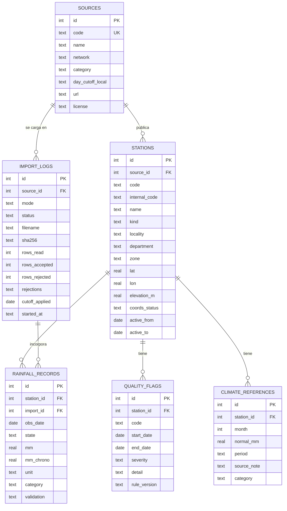

# Modelo de datos

Borrador para revisión de Santiago (responsable de la base de datos) y de Tomás. Describe las tablas, las reglas que protegen la calidad del dato y cómo se cargan las series del SIGA.

> PROTOTIPO · AI LAB Misión: Código Formosa · no es una herramienta oficial

## 1. Principio de diseño

**Un hueco no es 0 mm.** El modelo hace imposible guardar un día sin dato como cero: la regla vive en la base de datos (restricciones) y no solo en el código.

Un día de una estación puede estar en uno de tres estados:

| Estado | Significa | `mm` |
|---|---|---|
| `dato` | La fuente informó un valor (puede ser `0.0`: llovió cero) | número ≥ 0 |
| `fila_sin_valor` | La fuente devolvió el día, pero con la lluvia vacía | `NULL` |
| `sin_fila` | La fuente no devolvió ese día | `NULL` |

Los dos últimos son huecos. Se distinguen porque dicen cosas distintas sobre la fuente (reportó vacío vs. no reportó), y esa diferencia se muestra en la auditoría.

## 2. Diagrama



## 3. Tablas

### `sources` — de dónde viene cada dato

| Columna | Tipo | Notas |
|---|---|---|
| `id` | entero | clave primaria |
| `code` | texto único | `siga_inta`, `provincial`, `chirps`, … |
| `name`, `url`, `license` | texto | para la ficha de fuentes |
| `network` | texto | red de medición (INTA, provincial, SMN…) |
| `category` | texto | categoría por defecto de sus datos: `observado`, `referencia` o `estimado` |
| `day_cutoff_local` | texto | hora de corte del «día de lluvia»: `07:00` (red provincial, UPCA, SNIH) o `09:00` (SMN, INTA convencional). Alimenta la advertencia de horario de corte distinto |

### `stations` — dónde se mide

| Columna | Tipo | Notas |
|---|---|---|
| `id` | entero | clave primaria |
| `source_id` | FK → `sources` | red a la que pertenece |
| `code` | texto | identificador en la fuente (ej. `424`). Único junto con `source_id` |
| `internal_code`, `name`, `kind`, `locality` | texto | `kind`: convencional, automática, etc. |
| `department`, `zone` | texto, **admite vacío** | para filtrar por zona; vacío hasta confirmarlo |
| `lat`, `lon`, `elevation_m` | número, **admite vacío** | **nunca se inventan** |
| `coords_status` | texto | `verificada` o `pendiente`. Las estaciones sin coordenadas no entran en la regla de vecinas ni en el mapa |
| `active_from`, `active_to` | fecha | período con datos en la fuente |

### `rainfall_records` — la lluvia, un registro por estación y día

| Columna | Tipo | Notas |
|---|---|---|
| `id` | entero | clave primaria |
| `station_id` | FK → `stations` | |
| `import_id` | FK → `import_logs` | de qué carga viene (trazabilidad) |
| `obs_date` | fecha | día de la observación |
| `state` | texto | `dato`, `fila_sin_valor` o `sin_fila` |
| `mm` | decimal, **admite vacío** | lluvia del día. En el SIGA es `precDiaPlub` (la que usa la herramienta) |
| `mm_chrono` | decimal, **admite vacío** | lluvia cronológica (`precDiaCrono`), solo estaciones automáticas. **Informativa: nunca rellena un hueco de `mm`** |
| `unit` | texto | `mm` |
| `category` | texto | `observado`, `referencia` o `estimado` |
| `validation` | texto | `validado` o `sin_validar` (alimenta la advertencia de dato sin validar) |

Restricciones (en la base de datos):

```sql
-- Un registro por estación, día y categoría (permite tener observado y estimado el mismo día)
UNIQUE (station_id, obs_date, category)

-- La lluvia no puede ser negativa
CHECK (mm IS NULL OR mm >= 0)
CHECK (mm_chrono IS NULL OR mm_chrono >= 0)

-- Hueco ≠ 0 mm: hay valor si y solo si el estado es «dato»
CHECK ((state = 'dato') = (mm IS NOT NULL))

-- Valores permitidos
CHECK (state IN ('dato', 'fila_sin_valor', 'sin_fila'))
CHECK (category IN ('observado', 'referencia', 'estimado'))
CHECK (unit = 'mm')
```

Compatibles con SQLite y PostgreSQL. En SQLAlchemy se declaran como `CheckConstraint` y `UniqueConstraint`, con `Enum(..., native_enum=False)`.

Índices: la restricción única ya cubre las búsquedas por estación y fecha. Además hay un índice por `obs_date` y otro por `(category, obs_date)` para consultas de toda la provincia en un período, y en `stations` uno por `zone` y otro por `department` (migración `0002`).

### `quality_flags` — advertencias que abarcan un período

Una racha de ceros no es una propiedad de un día sino de un tramo. Por eso las banderas se guardan por **rango de fechas** y no marcando cada registro.

| Columna | Tipo | Notas |
|---|---|---|
| `station_id` | FK → `stations` | |
| `code` | texto | `ceros_prolongados`, `inconsistente_con_vecinas`, `cobertura_baja`… |
| `start_date`, `end_date` | fecha | tramo afectado |
| `severity` | texto | `aviso` o `alerta` (descriptiva; no es una alerta de riesgo) |
| `detail` | texto (JSON) | datos que explican la advertencia (por ejemplo, acumulado de la estación vecina en el mismo tramo) |
| `rule_version` | texto | versión de la regla que la generó, para poder recalcular |

Las banderas se **recalculan** a partir de los registros; no son un dato de la fuente. Se recalculan solas después de cada carga confirmada (API y línea de comandos) y a mano con `python -m app.cli recompute-flags`; correrlo dos veces no duplica nada (se reemplaza el conjunto de la estación y la regla).

**Qué columnas lee Go:** Go no calcula banderas, solo las lee. Usa `station_id`, `code`, `start_date`, `end_date`, `severity`, `detail` y `rule_version`. Los umbrales viven en Python (`app/domain/quality.py`) y se guardan en `detail` (por ejemplo `min_days`); no se cambian sin avisar.

### `field_reports` — lluvia anotada por la policía donde no hay estación

Un reporte por fila: fecha (`obs_date`), `mm` (≥ 0), lugar, quién reporta, ubicación (`lat`/`lon`, ambas o ninguna), `location_status` (`informada` o `pendiente`), `location_source` (`dispositivo` o `manual`, vacío si no hay ubicación), `category` (siempre `observado`), `validation` (siempre `sin_validar` al entrar), `source` (`reporte_policial`) y `created_at`.

- **No es una lectura de estación:** va en su propia tabla y **nunca se suma** a las series ni a los acumulados. Se distingue por su fuente y porque no tiene estación.
- **Sin ubicación queda pendiente:** no se inventa ni se completa con la del lugar.
- Se rechaza `mm` negativo o mayor a 1000 (freno a errores de tipeo, no una regla meteorológica), fechas posteriores al corte (31/10/2026), textos vacíos o con caracteres de control y coordenadas fuera de rango.
- Cargar (`POST /api/field-reports`) y listar (`GET`) piden la clave de administración, igual que la importación: el listado incluye el nombre de quien reporta, un dato personal.

### `import_logs` — registro de cada carga (auditoría)

Una fila por importación: archivo (nombre saneado y huella `sha256`), modo (`audit` si solo se simuló, `commit` si se guardó), estado, filas leídas, aceptadas y rechazadas, motivos de rechazo agrupados (JSON), fecha de corte aplicada y cuándo se hizo. Es la base del **registro de limpieza** que pide la entrega.

### `climate_references` — normales climáticas

Normal mensual (`month` 1–12) en mm, con período de cálculo y nota de fuente. Categoría siempre `referencia`. **Solo se carga con fuente verificada**; si no hay, la tabla queda vacía y se documenta. Hoy hay una sola normal: la de **Formosa Aero (SMN, 1991-2020)**, ver `docs/fuentes/smn-normales.md`. No hay normales para las demás estaciones.

## 4. Reglas que se aplican al cargar y al consultar

1. **Corte 31/10/2026:** al importar se rechazan los registros con fecha posterior, con motivo registrado. Las consultas también lo respetan.
2. **Categorías separadas:** observado, referencia y estimado nunca se suman ni se promedian entre sí.
3. **Idempotencia:** volver a cargar el mismo archivo no duplica filas (clave única + actualización por clave).
4. **Rechazos con motivo:** valores negativos, fechas inválidas, estaciones inexistentes, estados incoherentes. Nada se descarta en silencio.
5. **Calendario completo:** las series del SIGA se guardan con todos los días del período, incluidos los `sin_fila`, para que la cobertura se calcule directo.

## 5. Métricas derivadas (no se guardan, se calculan)

Para una estación y un período de `N` días:

| Métrica | Cálculo |
|---|---|
| Acumulado | suma de `mm` de los días con `state = 'dato'` |
| Días con dato | cantidad de días `dato` |
| Días sin dato | `fila_sin_valor` + `sin_fila` (se informan por separado) |
| Cobertura | días con dato / `N` |

Un acumulado con cobertura baja **siempre** se muestra con su advertencia.

### Salud de la red (`GET /api/network/health`)

Para cada estación se toma su **última lectura observada con valor** (estado `dato`, categoría `observado`, hasta la fecha de corte) y se cuentan los días desde entonces **hasta el corte, no hasta hoy**.

| Estado | Cuándo |
|---|---|
| `activa` | la última lectura está a 30 días o menos del corte |
| `en_silencio` | la última lectura está a más de 30 días del corte |
| `sin_datos` | nunca tuvo una lectura con valor (solo huecos, nada, o solo referencias) |

El umbral de **30 días es una propuesta a confirmar con el equipo**; se puede pedir otro con `silent_after_days` (1 a 365). Un silencio nunca devuelve `0 mm`: muestra la fecha y los milímetros de su última lectura real, y una estación sin datos devuelve todo vacío. Un `0` medido (lluvia cero) sí es una lectura y la estación sigue activa.

## 6. Cómo se cargan las series del SIGA

`docs/datos/lluvia_diaria_siga_formosa.csv` (7.648 filas, una por estación y día) entra uno a uno:

| Columna del CSV | Columna de la base |
|---|---|
| `estacion_id` | `stations.code` (se busca la estación) |
| `fecha` | `obs_date` |
| `mm_pluviometrica` | `mm` |
| `mm_cronologica` | `mm_chrono` |
| `unidad` | `unit` |
| `estado` | `state` |
| `categoria` (`OBSERVADO`) | `category` (`observado`) |
| `bandera` (`ceros_prolongados`) | no se copia: se regenera como fila de `quality_flags` con su tramo |
| `fuente` | `sources.code` (`siga_inta`) |

Verificación de la carga: 7.648 filas en total; 4.378 + 887 = 5.265 con `dato`; 365 con `fila_sin_valor` (7 de ellas traen valor cronológico, que no rellena el hueco); 2.018 `sin_fila`.

### Consultas de acumulado

Una fila por estación, **incluso las que no tienen registros en el período** (aparecen con `NULL`, no se omiten). Se filtra por **una** categoría: observado, referencia y estimado nunca se suman. `SUM(mm)` ignora los huecos (`mm` es `NULL`) y devuelve `NULL` si no hubo ningún día con dato: un hueco no suma 0.

La API permite consultar todas las estaciones si se omiten los filtros, o limitar el resultado a una estación o zona. En todos los casos devuelve acumulados separados por estación, nunca un total provincial ni una suma de estaciones.

```sql
-- :cat = 'observado' | 'referencia' | 'estimado'; :desde y :hasta inclusivos
SELECT s.id,
       s.name,
       COALESCE(SUM(CASE WHEN r.state = 'dato' THEN 1 ELSE 0 END), 0)                  AS dias_con_dato,
       COALESCE(SUM(CASE WHEN r.id IS NOT NULL AND r.state <> 'dato' THEN 1 ELSE 0 END), 0) AS dias_sin_valor,
       SUM(r.mm)                                                                       AS acumulado_mm
FROM stations s
LEFT JOIN rainfall_records r
       ON r.station_id = s.id
      AND r.category = :cat
      AND r.obs_date BETWEEN :desde AND :hasta
WHERE s.id = :estacion          -- por estación
   -- s.zone = :zona            -- por zona
   -- s.department = :depto     -- por departamento
GROUP BY s.id, s.name
ORDER BY s.id;
```

Los días que no existen en la base (sin fila) no figuran en `dias_sin_valor`: se calculan como la longitud del período menos los días con registro. Implementación de referencia: `SqlSeriesRepository.accumulated_by_station` y `accumulated_by_group` (`apps/backend/app/repositories/series.py`).

## 7. Escala y continuidad

- **SQLite** para la demo; **PostgreSQL** cambiando solo `DATABASE_URL` (sin tipos propios de un motor).
- `lat`/`lon` hoy son columnas numéricas. Si se pasa a **PostGIS**, se agrega una columna de geometría sin romper nada.
- Una fuente nueva (INA, red provincial) es una fila nueva en `sources` y un conector; no cambia el esquema.
- Los estimados (por ejemplo CHIRPS en los puntos de las estaciones) entran como `category = 'estimado'` desde su propia fuente.

## 8. Decisiones a confirmar en la revisión

1. **`mm` y `mm_chrono` en la misma fila** (como viene el SIGA) en lugar de una fila por tipo de medida: se eligió para que las 7.648 filas coincidan una a una con el CSV y para evitar duplicar el estado. Si otras fuentes traen más tipos de medida, conviene revisarlo.
2. **Guardar los días `sin_fila`** como filas: simplifica la cobertura a costa de más filas (con 34 estaciones y 10 años serían unas 124.000, sin problema para SQLite).
3. **Clave única `(station_id, obs_date, category)`**: permite que el mismo día tenga un observado y un estimado, pero no dos observados de fuentes distintas para la misma estación. Si una estación aparece en dos redes, se modela como dos estaciones.
4. **`department` y `zone` vacíos** hasta que haya un criterio de zonas confirmado por la mentoría.
